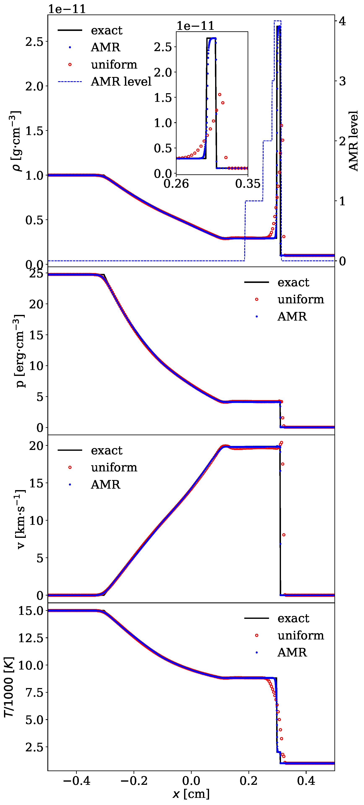
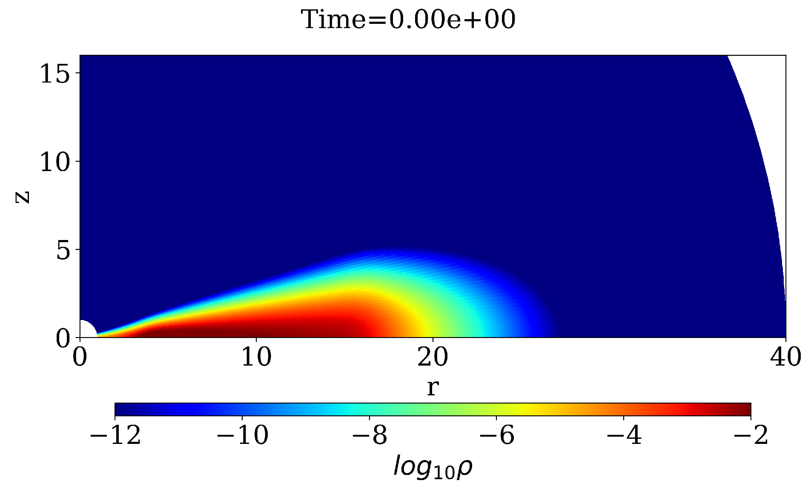
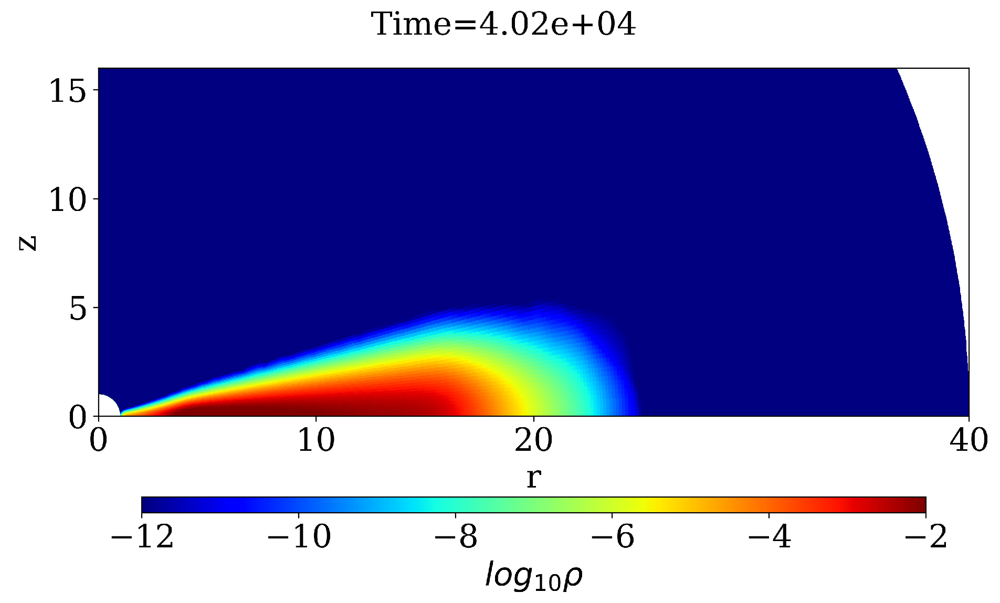
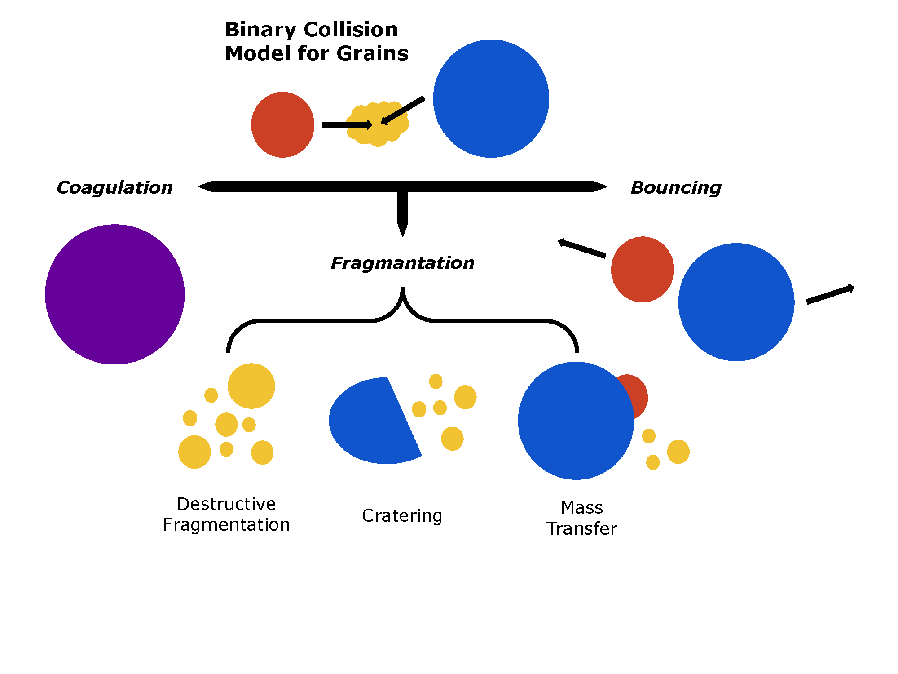

# Computational Astrophysics & High-Performance Computing

Accurate modeling of stellar envelopes, planetary accretion shocks, and circumplanetary disks requires numerical methods that handle **non-ideal equations of state (EOS)**, **stiff radiation transport**, and **long-term angular momentum conservation** without sacrificing performance.

---

## 1. Exact & HLLC Riemann Solvers for General Equations of State

  

    
    

      General-EOS shock-tube benchmark using the second-order MUSCL scheme in <code>Guangqi</code> (Chen &amp; Bai 2026).
    

  

  

    

      To solve hydrodynamic problems with realistic astrophysical EOS (including H2 dissociation and H/He ionization), we developed a novel <b>exact general-EOS Riemann solver</b> and a corresponding <b>HLLC approximate Riemann solver</b> (<a href="https://arxiv.org/abs/1903.04568" target="_blank" rel="noopener noreferrer">Chen et al. 2019</a>).
    

    <ul>
      <li>Existence and uniqueness of the exact solution are guaranteed for any monotone EOS.</li>
      <li>Matches the classical exact Euler solver in the ideal-gas limit while accurately capturing real-gas shock transitions.</li>
      <li>In <a href="https://arxiv.org/abs/2602.12545" target="_blank" rel="noopener noreferrer">Chen &amp; Bai (2026)</a>, we applied the second-order <b>MUSCL scheme</b> to the general-EOS solver for high-resolution shock capturing.</li>
      <li><b>Subsequently adopted by <a href="https://arxiv.org/abs/2005.06651" target="_blank" rel="noopener noreferrer"><code>Athena++</code></a> (Stone et al. 2020) and extended by <a href="https://scixplorer.org/abs/2020ApJS..248....7C/abstract" target="_blank" rel="noopener noreferrer">Matthew S. B. Coleman (2020)</a> as its default general-EOS hydrodynamic solver.</b></li>
    </ul>
  

---

## 2. Guangqi (光启): 2D Radiation Hydrodynamics with Realistic EOS

I am the lead designer and developer of **`Guangqi`**, a two-dimensional, finite-volume radiation-hydrodynamic code written in **Fortran** and parallelized with **MPI** ([Chen & Bai 2026](https://arxiv.org/abs/2602.12545)). Key capabilities and applications include:

- **Coupled Hydrodynamics & Implicit Radiation Transport:** Solves the hydrodynamic equations simultaneously with implicit flux-limited diffusion (FLD) radiation transport.
- **Analytic LTE H/He Equation of State:** Self-consistently captures H2 dissociation, H ionization, and He first/second ionization.
- **Curvilinear Geometries & PSAMA:** Supports Cartesian and spherical-polar coordinates, featuring our **Passive-Scalar Angular Momentum Algorithm (PSAMA)** for accurate angular-momentum conservation in rotating disks.
- **Scientific Applications in Stellar & Planetary Astrophysics:** `Guangqi` has been applied across our planetary and stellar programs, including planetary accretion shocks ([Chen & Bai 2022](https://arxiv.org/abs/2201.07453); [Zha & Chen 2026](https://arxiv.org/abs/2611.24615)), viscously heated circumplanetary disks ([Chen, Yang & Bai 2026](https://arxiv.org/abs/2610.21284)), and common envelope evolution / luminous red novae ([Chen & Ivanova 2024](https://arxiv.org/abs/2402.05686); [Chen 2026](https://arxiv.org/abs/2510.14173); [Chen et al. 2026](https://arxiv.org/abs/2610.05769)).

  

    
    
  

  

    2D isolated accretion disk benchmark in spherical-polar coordinates evolved with <code>Guangqi</code> using PSAMA (Chen &amp; Bai 2026). <b>Left panel:</b> Initial density distribution of the isolated disk. <b>Right panel:</b> Density after 6,400 inner orbital periods (<i>t</i> = 6400 <i>P</i>in), demonstrating long-term stability and angular-momentum conservation.
  

---

## 3. GRACE-DG: Discontinuous Galerkin Dust Coagulation-Fragmentation

  

    
    

      Collisional outcome regimes (coagulation, bouncing, cratering, mass transfer, and fragmentation) modeled in <code>GRACE-DG</code> (Yang, Chen &amp; Bai 2026).
    

  

  

    

      I co-authored the open-source code <b><a href="https://github.com/jing-xps/GRACE-DG" target="_blank" rel="noopener noreferrer"><code>GRACE-DG</code></a></b> (GRAin Collisional Evolution – Discontinuous Galerkin; <a href="https://arxiv.org/abs/2607.13740" target="_blank" rel="noopener noreferrer">Yang, Chen &amp; Bai 2026</a>) to solve the general nonlinear coagulation-fragmentation equations for dust evolution in protoplanetary disks (<a href="https://github.com/jing-xps/GRACE-DG" target="_blank" rel="noopener noreferrer">GitHub repository</a>). Key advantages include:
    

    <ul>
      <li><b>Conservative Nonlinear Fragmentation:</b> Derives a new conservative mass-flux formulation that captures general nonlinear fragmentation processes, including cratering and mass transfer.</li>
      <li><b>Positivity-Preserving High-Order DG Scheme:</b> Formulated on the conservative Smoluchowski equation, preserving positivity for both coagulation and fragmentation while alleviating the over-diffusion of existing discretized algorithms.</li>
      <li><b>Convergence &amp; Hydrodynamic Readiness:</b> Demonstrates high-order convergence and robustness in coupled aggregation–breakage simulations with fewer mass bins, making it well suited for integration into hydrodynamic codes.</li>
    </ul>
  

