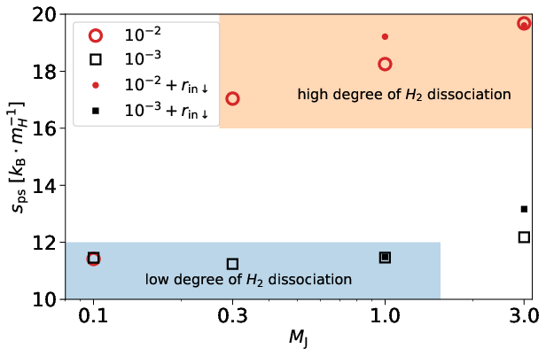
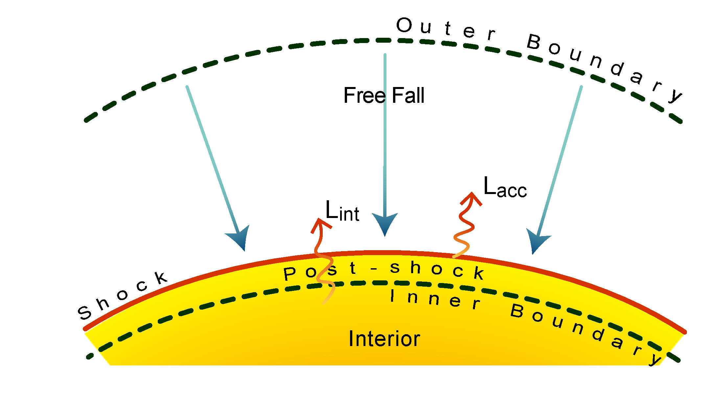
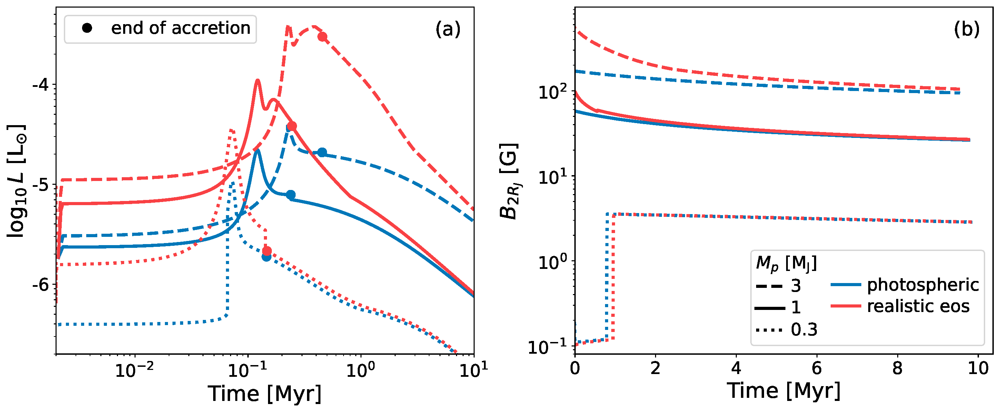
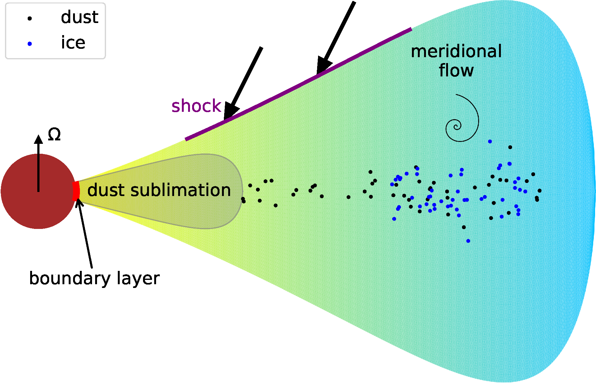
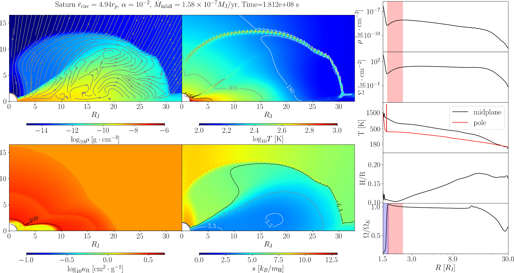

# Planetary & Moon Formation

Direct imaging of actively accreting protoplanets (such as PDS 70 b and c) and upcoming Solar System missions (*Tianwen-4*, *Europa Clipper*, *JUICE*) demand first-principles models of how gas giants and their moons assemble. My research connects **non-ideal gas thermodynamics**, **2D/3D radiation hydrodynamics (RHD) and MHD**, and **dust coagulation** to multi-wavelength observables.

---

## 1. Planetary Accretion Shocks & Primordial Thermodynamics

  

    
    

      Post-shock specific entropy <i>s</i>ps vs. planet mass <i>Mp</i> for accretion rates of 10−2 (red) and 10−3 <i>M</i>⊕ yr−1 (black; Chen &amp; Bai 2022).
    

  

  

    

      During the runaway gas accretion phase, infalling gas approaches free-fall velocity and forms a luminous accretion shock at the planet's surface. Using 1D RHD simulations with a realistic hydrogen/helium equation of state, we showed that <b>molecular hydrogen (H2) dissociation</b> at ∼2000 K drives a sharp jump in post-shock entropy at high accretion rates, leading to <b>hot-start</b> planet formation (<a href="https://arxiv.org/abs/2201.07453" target="_blank" rel="noopener noreferrer">Chen &amp; Bai 2022</a>).
    

    

      Building on this, we coupled first-principles shock models to planetary interior evolution (<code>MESA</code>) via a physics-informed neural network (<a href="https://arxiv.org/abs/2611.24615" target="_blank" rel="noopener noreferrer">Zha &amp; Chen 2026</a>), predicting initial intrinsic luminosities 4–10 times higher than canonical cold-start models and linking accretion physics directly to primordial dynamo magnetic fields. Under optimistic assumptions, the maximum magnetic field strength at 2 <i>R</i>J reaches a few gauss for a 0.3 <i>M</i>J planet, ∼100 G for 1 <i>M</i>J, and ∼500 G for 3 <i>M</i>J.
    

  

  

    
    
  

  

    <b>Left panel:</b> Schematic of planetary accretion shock physics: gas infalls at free-fall velocity, passes through an accretion shock at the top of the atmosphere, and settles onto deeper layers under internal (<i>L</i>int) and accretion (<i>L</i>acc) luminosities (Zha &amp; Chen 2026). <b>Right panel:</b> Evolution of planetary luminosity <i>L</i> (a) and primordial dynamo magnetic field strength <i>B</i>2<i>R</i>J (b) for <i>Mp</i> = 0.3, 1, and 3 <i>M</i>J, comparing our realistic-EOS shock boundary conditions (red) against canonical cold-start photospheric models (blue; Zha &amp; Chen 2026), with filled dots marking the end of accretion.
  

---

## 2. Viscously Heated Circumplanetary Disks (CPDs) & Moon Formation

Moons assemble inside circumplanetary disks, whose temperature, ionization, and dust distribution govern satellite survival and composition. Using `Guangqi` with a realistic EOS and our passive-scalar angular momentum algorithm (PSAMA), we developed an axisymmetric viscous RHD model of CPDs ([Chen, Yang & Bai 2026](https://arxiv.org/abs/2610.21284)) that self-consistently resolves:

- The **boundary layer** connecting the disk to the planet
- The **inner dust sublimation zone** and snowline location
- **Meridional circulation** and a **high-latitude supersonic accretion stream** (2–5% of the total accretion rate) capable of powering observable Hα emission

  

    
    
  

  

    <b>Left panel:</b> Schematic of a viscously heated CPD modeled with <code>Guangqi</code>, illustrating the boundary layer, dust sublimation zone, surface accretion shock, and meridional circulation (Chen, Yang &amp; Bai 2026). <b>Right panel:</b> Quasi-steady-state 2D RHD solution and radial midplane profiles for a Saturnian CPD model (Chen, Yang &amp; Bai 2026).
  

