# Stellar & Binary Evolution

Binary star interactions shape the demographics of compact binaries, Type Ia supernovae, and gravitational-wave sources. My stellar astrophysics research connects **first-principles radiation hydrodynamics (RHD)** and **realistic equations of state (EOS)** to time-domain transients and *Gaia* binary demographics.

---

## 1. Common Envelope Evolution & Luminous Red Novae

Common envelope evolution (CEE) is a pivotal yet poorly understood phase of binary evolution. Using the RHD code `Guangqi` with complete hydrogen and helium recombination physics, we demonstrated a **radiation-pressure driving mechanism**: near the recombination front (H+ + e− → H), bound-free and free-free opacity lowers the local effective Eddington luminosity so that radiation force overcomes gravity and accelerates the envelope outward ([Chen & Ivanova 2024](https://arxiv.org/abs/2402.05686); [Chen 2026](https://arxiv.org/abs/2510.14173)).

  

    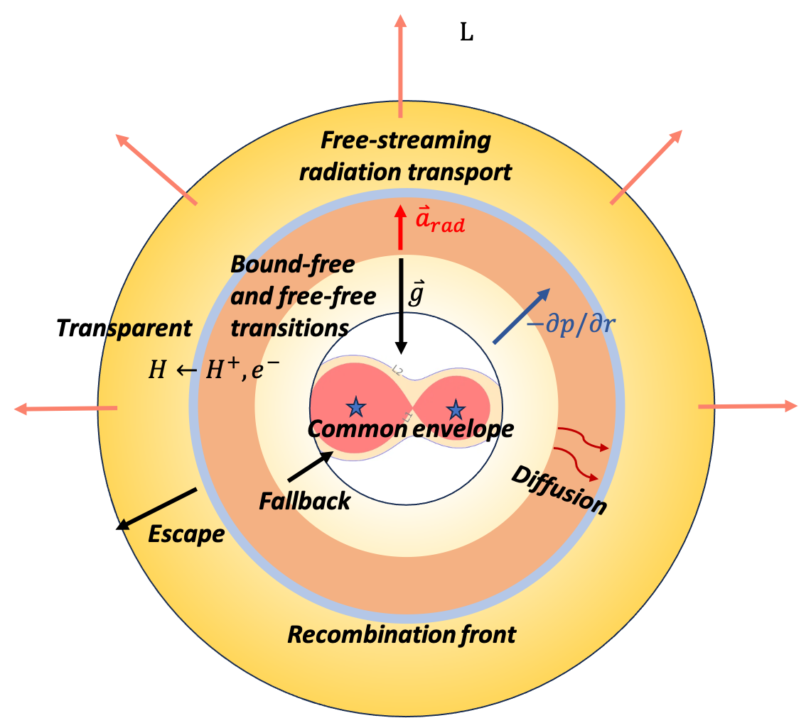
    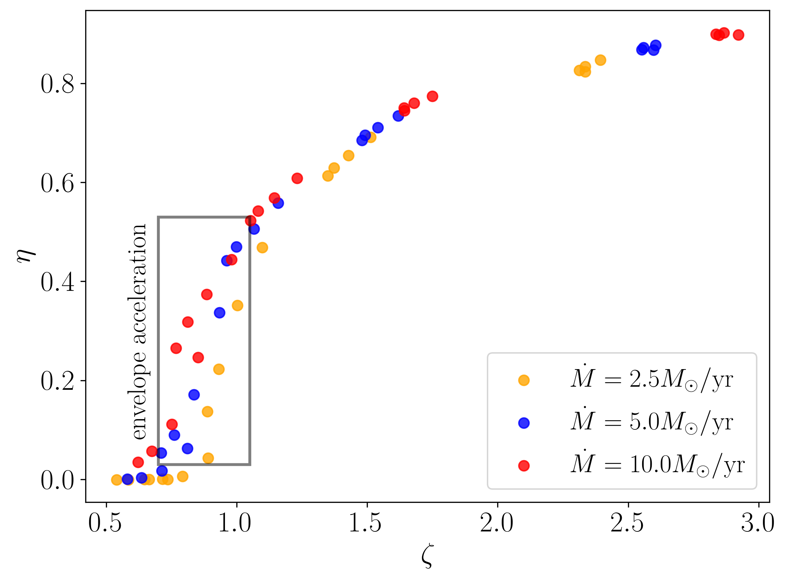
  

  

    <b>Left panel:</b> Schematic of the radiation-pressure-driven common envelope and LRN model (Chen & Ivanova 2024; Chen 2026). <b>Right panel:</b> Envelope ejection efficiency (<i>η</i>) vs. total-to-binding energy ratio (<i>ζ = Etot / |Ebind|</i>) across mass-loss rates from 1D RHD simulations (Chen 2026).
  

### Case Study: M31 Luminous Red Nova AT 2025abao

  

    

      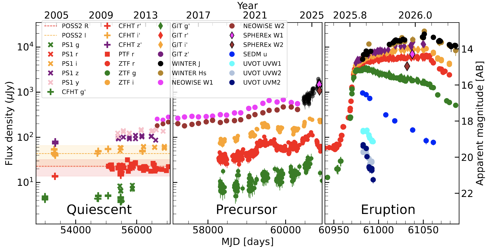
      

        Multi-wavelength light curve of AT 2025abao spanning 2004–2026 across its quiescent, seven-year precursor (plus several months in 2025 observed by WFST), pre-outburst dip, and eruption phases (<a href="https://arxiv.org/abs/2611.23470" target="_blank" rel="noopener noreferrer">Karambelkar et al. 2026</a>).
      

    

    

      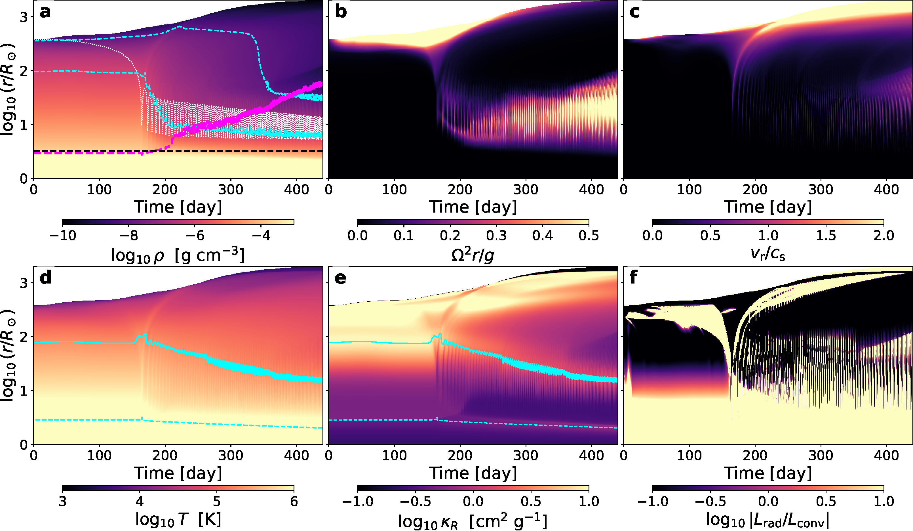
      

        1D <code>MESA</code> CEE evolution of the 6.9 <i>M</i>☉ AGB primary + 1.4 <i>M</i>☉ companion, showing density, centrifugal-to-gravity ratio, radial velocity, temperature, opacity, and radiative-to-convective luminosity (Chen et al. 2026).
      

    

    

      
      

        <b>Left:</b> Energy budget changes between 180–200 days and the initial CEE state across six decomposed components. <b>Right:</b> Kippenhahn density diagram showing envelope expansion and ~1.1 <i>M</i>☉ mass loss (Chen et al. 2026).
      

    

    

      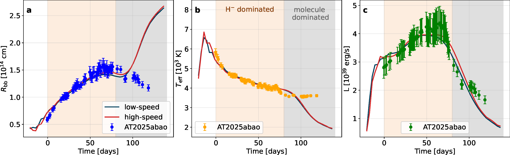
      

        Comparison of observed blackbody radius <i>R</i>bb, effective temperature <i>T</i>eff, and bolometric luminosity <i>L</i> with <code>RADMC-3D</code> post-processed low-speed (blue) and high-speed (red) <code>Guangqi</code> RHD models (Chen et al. 2026).
      

    

  

  

    

      Applying our self-consistent framework to <b>AT 2025abao</b> in M31 (<a href="https://arxiv.org/abs/2610.05769" target="_blank" rel="noopener noreferrer">Chen et al. 2026</a>), we modeled the full evolutionary sequence from its eight-year infrared precursor to its luminous red nova (LRN) outburst and spectral energy distribution (SED):
    

    <ul>
      <li><b>Wind Precursor (2018–2025):</b> A ~1.4 <i>M</i>☉ main-sequence companion spiraled slowly inward through the dense wind of a ~6.9 <i>M</i>☉ AGB primary (from ~480 to 380 <i>R</i>☉). Gravitational drag dissipated orbital energy in the optically thin wind, powering the gradual brightening from ~16,000 to ~50,000 <i>L</i>☉.</li>
      <li><b>CEE Spiral-In &amp; Pre-Outburst Dimming:</b> Once the companion plunged into the AGB envelope, rapid orbital decay in our <code>MESA</code> 1D CEE model lasted ~170 days before settling into an eccentric orbit from ~180 days onward (ongoing inspiral without merger). Decomposing the energy budget into six components shows that the released <b>orbital gravitational potential energy</b> and envelope internal energy are converted primarily into lifting the envelope (envelope gravitational potential energy <i>Φ</i>env), kinetic energy, and envelope rotational energy via angular-momentum transfer. Because the levitated envelope consumes most of this converted energy, the excess energy radiated away during the ~200-day plunge-in is only ~1.5 × 1045 erg—an average excess luminosity of only <b>~22,000 <i>L</i>☉</b>, lower than the peak wind-drag heating luminosity during the precursor. Combined with dust obscuration and reddening, this produces the observed <b>dimming prior to the outburst</b>.</li>
      <li><b>Outburst Onset &amp; Radiation-Driven Ejecta:</b> When the companion-induced shock broke out at the surface, it launched ~0.92 <i>M</i>☉ of ejecta (~1.25 × 1047 erg), driving a rapid ~5 mag <i>r</i>-band rise and ~90-day plateau at 3–4 × 1039 erg s−1. Modeled with <code>Guangqi</code> and Bayesian optimization, radiation-pressure gradients accelerate sub-escape material until ~0.57 <i>M</i>☉ escapes.</li>
      <li><b>H− Reddening &amp; SED Evolution:</b> Post-processing with <code>RADMC-3D</code> shows that the deeply embedded hydrogen recombination front (<i>T</i> ≈ 6000 K) acts as the photon-emitting sphere. Outward photons are scattered by H and H2 and absorbed by broad-band <b>H−</b> (<i>λ</i> &lt; 1.6 μm) and molecular opacity, reprocessing radiation to longer wavelengths, reddening the emergent SED, and matching the observed <i>R</i>bb, <i>T</i>eff, and bolometric luminosity <i>L</i>.</li>
    </ul>
  

### Multi-Dimensional CEE, Viewing Angle & Future Directions

  

    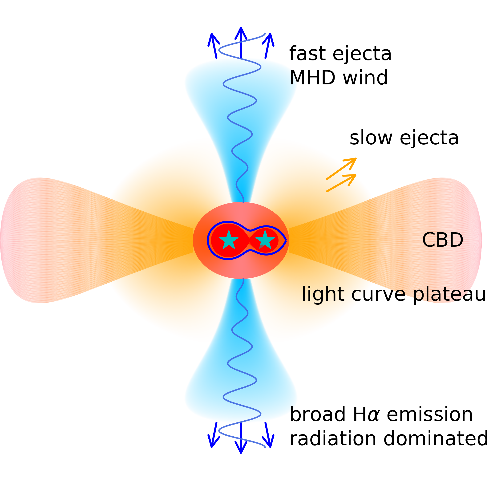
  

  

    

      In realistic multi-dimensional CEE, <b>viewing angle matters</b>: fast (and MHD) jets may emerge along the polar direction, whereas slow ejecta with speeds comparable to the surface escape velocity contribute the majority of the light-curve energy, together with possible collisions with pre-existing circumstellar material (CSM).
    

    

      Looking ahead, motivated by compact neutron-star and pulsar binaries discovered by <b>FAST</b>, we are extending <code>Guangqi</code> to 2D/3D RHD with anisotropic radiation transport, rotation, and convection, and developing AI-assisted progenitor inference agents for <b>LSST</b>, <b>WFST</b>, <b>Roman</b>, and <b>JWST</b>.
    

  

---

## 2. Wind-Roche-Lobe Overflow and AGB Mass Transfer

In asymptotic-giant-branch (AGB) binaries, stellar pulsations drive slow, dust-laden winds (∼10–20 km s−1) whose morphology and mass-transfer efficiency depend sensitively on the binary separation ([Chen et al. 2017](https://arxiv.org/abs/1702.06160); [Chen et al. 2018](https://arxiv.org/abs/1705.01998); [Chen et al. 2020](https://arxiv.org/abs/1910.08027)):

- **Small binary separation (Circumbinary Disks &amp; WRLOF):** When the companion orbits close to the AGB dust-formation zone, the system enters **wind-Roche-lobe overflow (WRLOF)**. The companion's gravity deflects the slow wind toward the orbital plane, increasing the equatorial optical depth (<i>τ</i>) and shielding the gas from outward radiative acceleration. As a result, high-angular-momentum ejecta remain gravitationally bound and form a **circumbinary disk** (as observed in **AR Puppis** and **L2 Puppis**), boosting mass-transfer efficiency onto the secondary by up to a factor of ∼8 over standard Bondi–Hoyle–Lyttleton (BHL) accretion.
- **Large binary separation (Spiral Outflows &amp; BHL Accretion):** When the binary separation is wide, the dust-driven wind accelerates past escape velocity before encountering the companion, transitioning to **BHL accretion** and sculpting large-scale **spiral outflows** (as seen in **LL Pegasi** and **R Sculptoris**).
- **Orbital Bifurcation &amp; *Gaia* Period Gap:** By tracking the balance of mass loss, mass transfer, and angular-momentum loss, our 3D RHD models predict an **orbital bifurcation point** separating shrinking and widening binaries—a physical mechanism directly relevant to the [*Gaia* DR3 600–800 day orbital period gap](https://www.alphaxiv.org/pdf/2309.15143) in evolved low-mass binaries.

  

    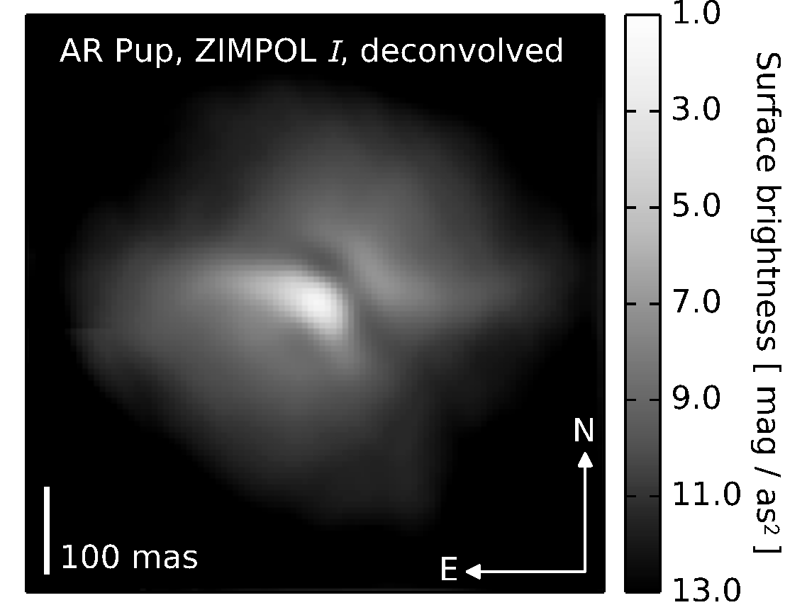
    
AR Puppis (Ertel et al. 2019)

  

  

    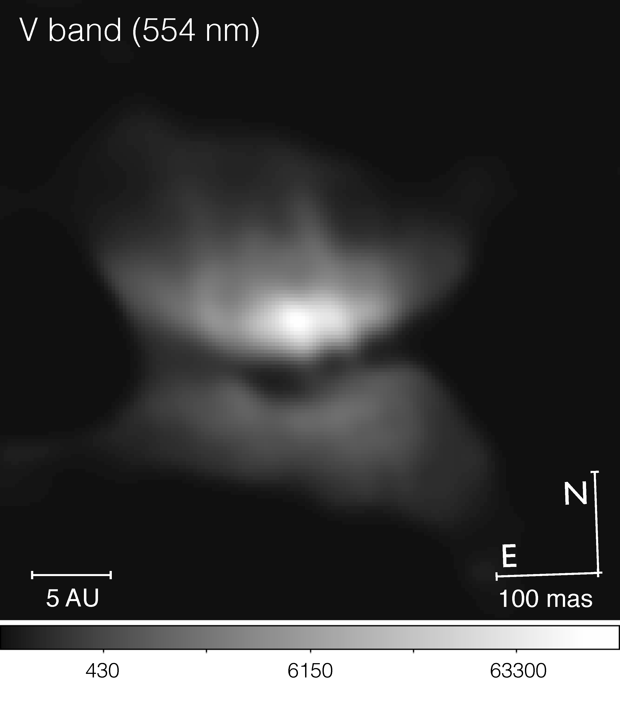
    
L2 Puppis (Kervella et al. 2015)

  

  

    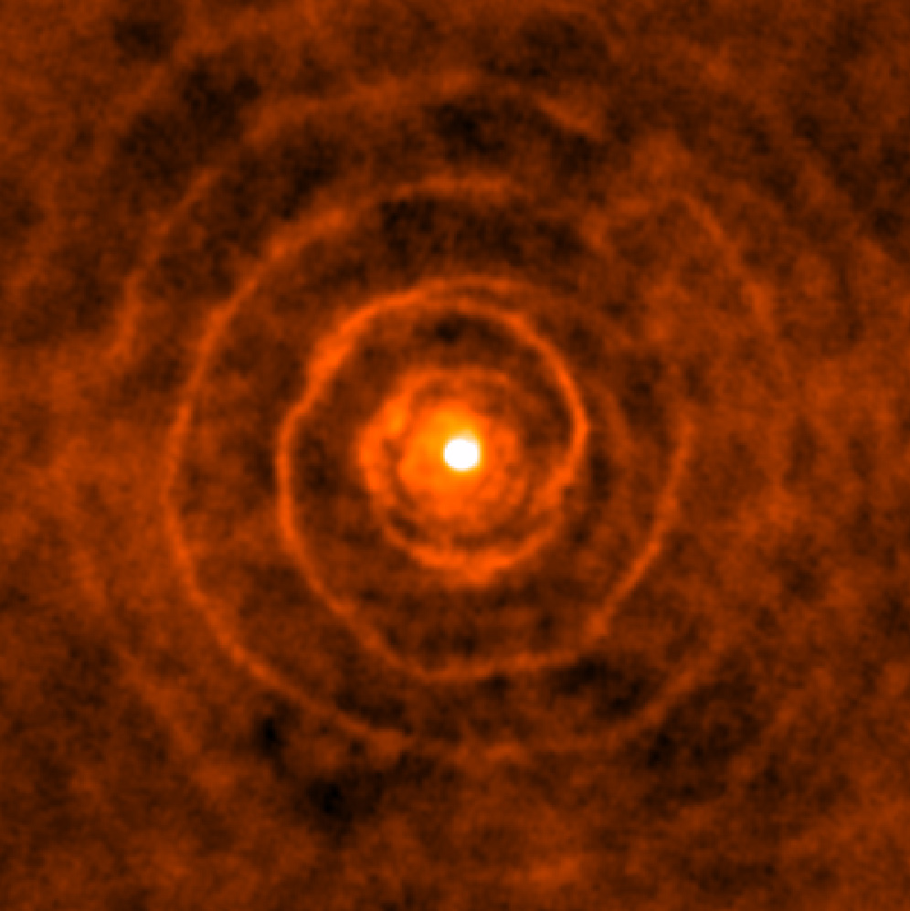
    
LL Pegasi (Kim et al. 2017)

  

  

    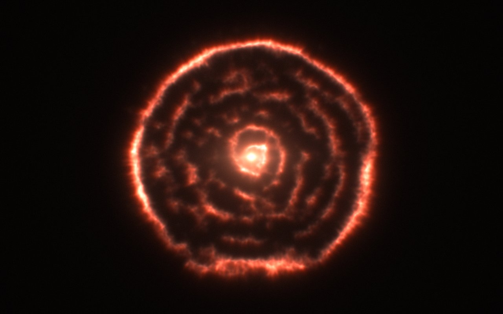
    
R Sculptoris (Maercker et al. 2012)

  

  

    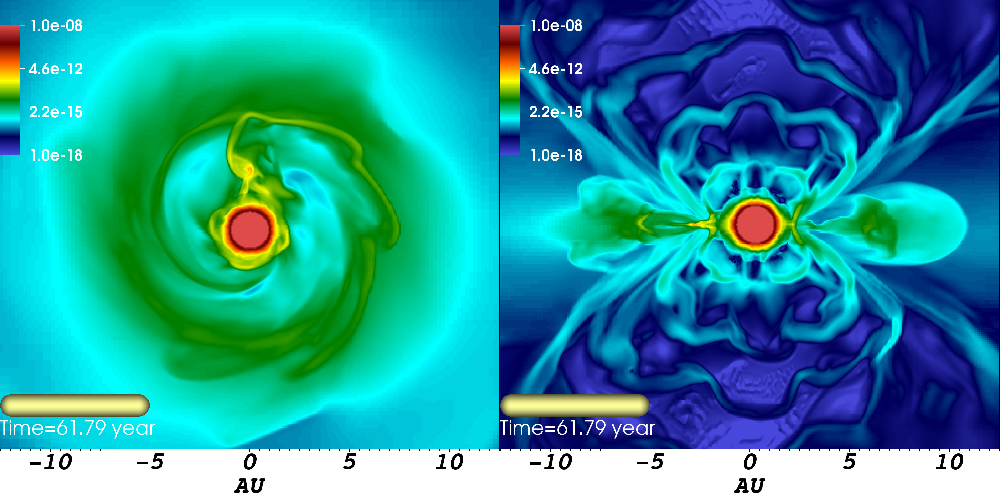
    

      

        Example of circumbinary disk formation at 3 AU in an AGB binary system, where slow wind material remains gravitationally bound near the orbital plane and forms a rotationally supported disk (<a href="https://www.youtube.com/watch?v=Pnk88Z4EPIs" target="_blank" rel="noopener noreferrer">Watch simulation video</a>).
      

    

  

  

    

      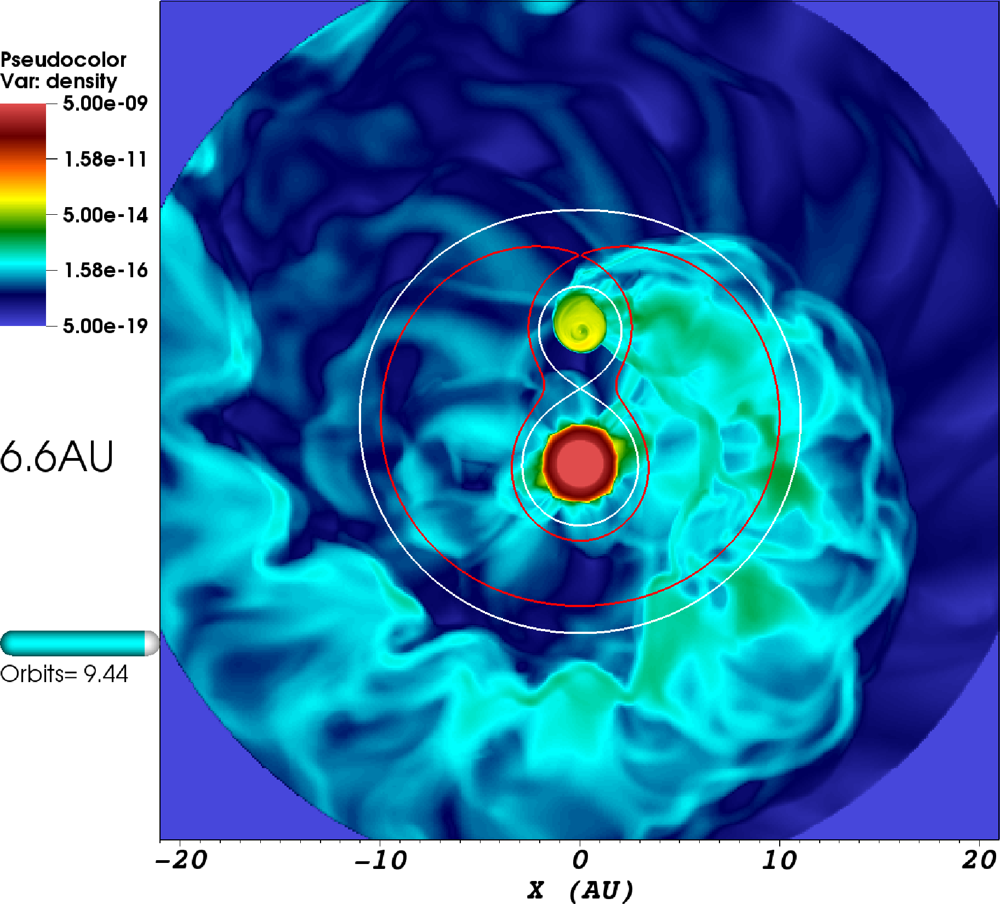
      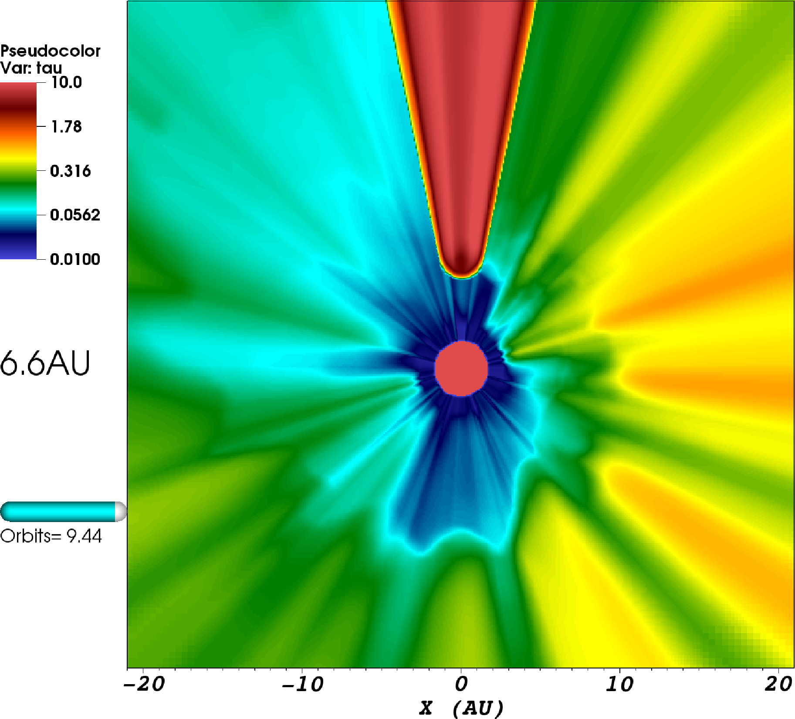
    

    

      

        Equatorial density (left) and optical depth (right) from our 3D RHD AGB binary model (<a href="https://arxiv.org/abs/1910.08027" target="_blank" rel="noopener noreferrer">Chen et al. 2020</a>; <a href="https://www.youtube.com/watch?v=bFAt_bOS0cw" target="_blank" rel="noopener noreferrer">Watch simulation video</a>).
      

    

  

